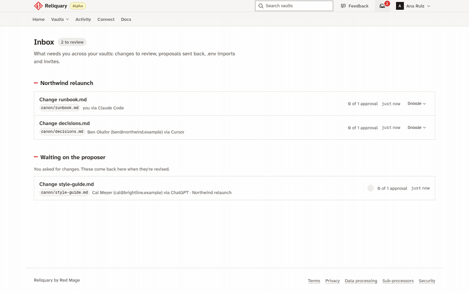
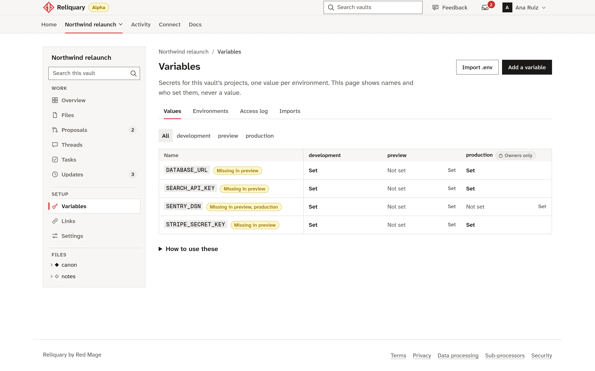
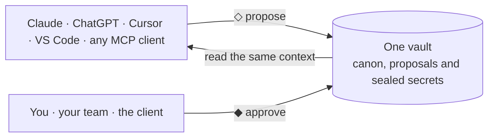

<p align="center"></p>

<h1 align="center">Reliquary</h1>

<p align="center"><strong>A secure second brain for people and their agents.</strong></p>

<p align="center">
Dead simple context to share across any AI tool. Claude, ChatGPT and Cursor read the same vault,<br>
agents propose, people approve, and secrets never reach a model.
</p>

<p align="center">
<a href="https://app.reliquary.redmage.cc/request-access"><strong>Request access</strong></a> ·
<a href="https://reliquary.redmage.cc/docs">Docs</a> ·
<a href="docs/public/how-to/self-host.md">Self-host</a> ·
<a href="https://www.npmjs.com/package/@reliquary-ai/cli">CLI</a> ·
<a href="https://reliquary.redmage.cc/roadmap">Roadmap</a> ·
<a href="CHANGELOG.md">Changelog</a>
</p>

<p align="center">
<a href="https://github.com/andersthemagi/reliquary/actions/workflows/test.yml"></a>
<a href="https://github.com/andersthemagi/reliquary/actions/workflows/codeql.yml"></a>
<a href="https://github.com/andersthemagi/reliquary/actions/workflows/deploy.yml"></a>
<a href="https://www.npmjs.com/package/@reliquary-ai/cli"></a>
<a href="LICENSE.md"></a>
<a href="https://reliquary.redmage.cc/roadmap"></a>
</p>

<p align="center"></p>

<p align="center">
<picture>
  <source media="(prefers-color-scheme: dark)" srcset="web/public/img/variables-dark.webp">
  
</picture>
</p>

<p align="center">More screens, of a fictional vault, are on <a href="https://reliquary.redmage.cc/#see">the landing page</a>; <code>scripts/demo-shots.sh</code> regenerates them from the running app.</p>



**◇ Proposed:** an agent wrote it and nobody has said yes.
**◆ Canon:** a person approved it, so every tool treats it as true.
**◆◆◆ Sealed:** a secret your tools can use and never see.

## Why Reliquary

- **Every AI tool, one vault.** Claude, ChatGPT, Cursor, VS Code and any MCP
  client read the same context. Reliquary holds no model, so switching tools
  loses nothing.
- **Built for agents and people together.** Agents read, take notes and
  propose. People review, approve and talk it through in threads. Every
  change lands in one append-only log.
- **Secrets stay secret.** No MCP tool, log line or error message returns a
  value. `reliquary run` puts it into one process and nowhere else.
- **Guarded by the database.** Every permission is a Postgres row-level
  security rule with a test that tries to break it on every push. A prompt
  can't talk its way past it.
- **Source available.** The code is public. Read it, run it, self-host it for
  free. Each release turns Apache 2.0 two years on, and the CLI is MIT.
- **Yours to take with you.** Export a whole vault as plain markdown any time,
  or delete it for good. No lock-in to us or to any AI vendor.

## What your agent can't do

An agent acts as its person, minus a ceiling. Whatever it's told, it can't:

- **Approve any change**
- **Change who approves what**
- **Add or remove people**
- **Reveal a secret's value**
- **Export or delete a vault**

Those need the person, signed in. They are enforced as row-level security in
Postgres, not in a prompt, and each rule has a hostile test that tries to break
it on every push. [How security works](docs/public/concepts/security.md).

## The problem, and what Reliquary does about it

| Today | With Reliquary |
| --- | --- |
| Every person and every tool has its own AI memory, so three people get three versions of the project. | One vault of approved context that every tool and every person reads, kept current by what agents propose and people approve. |
| Agents write things nobody checked, and the next agent believes them. | Agents propose. Nothing becomes canon until a person, or a quorum, approves it. |
| API keys travel by Slack and email and sit in `.env` files any agent can read. | Variables live in the vault. `reliquary run` puts them into one process; no AI tool ever gets a value. |
| Every AI vendor wants to be the one place your context lives, and your team already uses three of them. | Reliquary holds no model and takes any MCP client. Switch tools whenever you like; the context, the approvals and the log stay, and export as plain markdown. |

## How it works

**1. Connect any AI tool with one URL.** Paste the MCP URL into Claude,
ChatGPT, Cursor or VS Code and sign in; no token to copy. In Claude Code:

```bash
claude mcp add --transport http --scope user reliquary https://mcp.reliquary.redmage.cc/mcp
```

**2. Agents read and propose.** Open folders take notes directly. Canon
folders change only when a person approves, with a quorum if you want one.
Every change lands in an append-only log:

```text
◇ Your agent          proposed a change to brief.md
◆ You                 approved brief.md, now canon
◇ A teammate's agent  wrote notes/standup.md in an open folder
◆ A teammate          added DATABASE_URL to development
◆ reliquary run       put 1 variable into 1 process for a teammate
```

**3. Run with secrets, never show them.** The CLI puts a vault's variables
into one process. No MCP tool, log line or error message ever returns a
value.

```console
$ npx @reliquary-ai/cli login
$ reliquary run --vault "My project" --env development -- npm start
```

Or `reliquary env pull` writes a gitignored `.env`, and `reliquary env push`
sends an existing one for approval. [Use the CLI](docs/public/how-to/use-the-cli.md).

**Links** let your agents use another team's MCP tools (a project tracker, a
support inbox) without handing out the credential: Reliquary holds it and
proxies only the tools you grant.

## Who it's for

- **Teams on several AI tools.** Some people use Claude, some ChatGPT, some
  Cursor, and every `CLAUDE.md` and rules file drifts on its own. Give
  everyone the same reviewed context and keep keys out of chat messages.
- **Agencies and consultancies.** One vault per client, each person scoped to
  what they need, approvals on anything that becomes fact, and one log to
  show the client. [Keep client work separate](docs/public/how-to/keep-client-work-separate.md).
- **Solo builders.** Several tools and machines, one source of truth. Stop
  copying `CLAUDE.md` between tools and leaving `.env` files where any coding
  agent can read them.

## Get started

- **Hosted:** sign up at [reliquary.redmage.cc](https://reliquary.redmage.cc)
  with your email and create a vault. Free during the alpha; people are let
  in steadily, so a new account may wait a little before it can create one.
  Start with [Getting started](docs/public/tutorials/getting-started.md).
- **Self-hosted:** your own server with Docker Compose and no plan limits.
  [Self-host Reliquary](docs/public/how-to/self-host.md).
- **Already have a `.env` and a `CLAUDE.md`?**
  [Move a .env into a vault](docs/public/how-to/move-env-into-vault.md), then
  put `CLAUDE.md` in as canon and
  [point Claude Code at the vault](docs/public/how-to/connect-claude-code.md).

## Questions

<details>
<summary><strong>Is Reliquary an AI model or a chatbot?</strong></summary>

No. It runs no model, doesn't search your Drive or Slack, and isn't a memory
that writes itself. It holds context and credentials, and the AI tools you
already use connect to it over MCP.
</details>

<details>
<summary><strong>How is it different from Claude Projects or ChatGPT memory?</strong></summary>

It works across vendors, people approve changes before they become fact, and
it holds credentials as well as context.
</details>

<details>
<summary><strong>Can my agents see my secrets?</strong></summary>

Not through Reliquary: no MCP tool returns a variable's value. `reliquary run`
puts values into one process, and an agent that can run commands in that
process could read them there. Values are encrypted with a key held by the
app, not the database, so the operator could technically decrypt them.
[The security page](docs/public/concepts/security.md) says what that means.
</details>

<details>
<summary><strong>Is it for regulated data?</strong></summary>

Not yet. There's no SOC 2 report or SSO today. Don't store health or payment
card data in it.
</details>

<details>
<summary><strong>Can I leave?</strong></summary>

Yes. An owner can export a whole vault as plain markdown at any time, delete
it for good, or move it to a self-hosted Reliquary.
</details>

<details>
<summary><strong>What will it cost after the alpha?</strong></summary>

Nothing is billed today. The plan is paid vaults for teams that need more
room, ways to support the project, and enough to keep the lights on. You'll
hear well before anything is billed, and self-hosting stays free.
</details>

## Status

Alpha: things change and may break; data is backed up daily. What's being
built is on [the roadmap](https://reliquary.redmage.cc/roadmap), what shipped
is in the [changelog](CHANGELOG.md), and the design and build order are in
[docs/design.md](docs/design.md).

## Inside

TypeScript on Node with no web framework: small `node:http` servers that
reach Postgres 17 through `pg`. Postgres enforces every permission with
row-level security, Supabase Auth signs people in, and the public site ships
no client-side script. Hosted on Netlify and Supabase, or self-hosted with
Docker Compose. The CLI has no runtime dependencies.

| Path | What it is |
| --- | --- |
| `supabase/migrations/` | The schema and every access rule, with hostile tests in `supabase/tests/` |
| `mcp/` | The remote MCP endpoint |
| `web/` | The web app, the public site and the docs it serves |
| `cli/` | The CLI, published as `@reliquary-ai/cli` |
| `deploy/` | Self-hosting with Docker Compose; smoke test `deploy/test.sh` |
| `docs/public/` | The public docs, served at [/docs](https://reliquary.redmage.cc/docs) |
| `docs/` | The design and internal docs; [docs/README.md](docs/README.md) says what to read first |
| `spikes/`, `pilot/` | Research that informed the design, not the product |

## Contributing

[CONTRIBUTING.md](CONTRIBUTING.md) covers what you need installed, the
day-to-day loop and how a change is reviewed. [AGENTS.md](AGENTS.md) is the
manual for agents and people alike: guardrails, testing policy and
conventions. Issues labelled
[good first issue](https://github.com/andersthemagi/reliquary/labels/good%20first%20issue)
are written so someone new can pick them up.

## License

The code is public. The server (everything outside `cli/`) is under the
Functional Source License 1.1 with an Apache 2.0 future license
([LICENSE.md](LICENSE.md)): use, change and self-host it for any purpose
except offering it to others as a competing product or service, and each
version becomes Apache 2.0 two years after its release. Hosting Reliquary
for others needs a commercial license from Red Mage (andres@redmage.cc).
The CLI in `cli/` is MIT ([cli/LICENSE](cli/LICENSE)).

---

<p align="center">Built in Barcelona by Andrés of <a href="https://redmage.cc">Red Mage</a>, out of running one vault per client as a consultant.</p>
